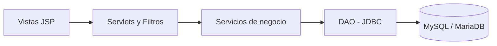
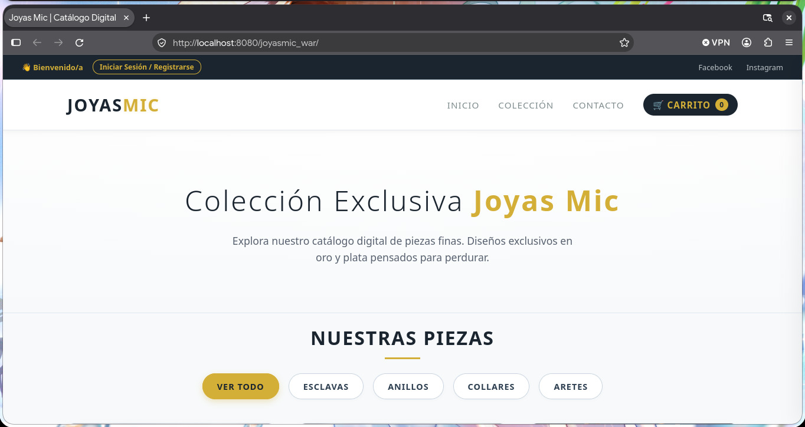
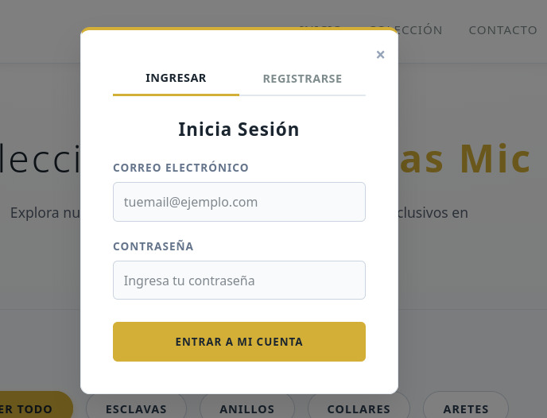
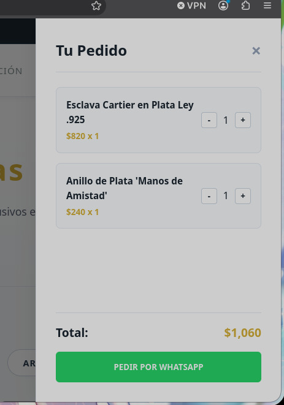
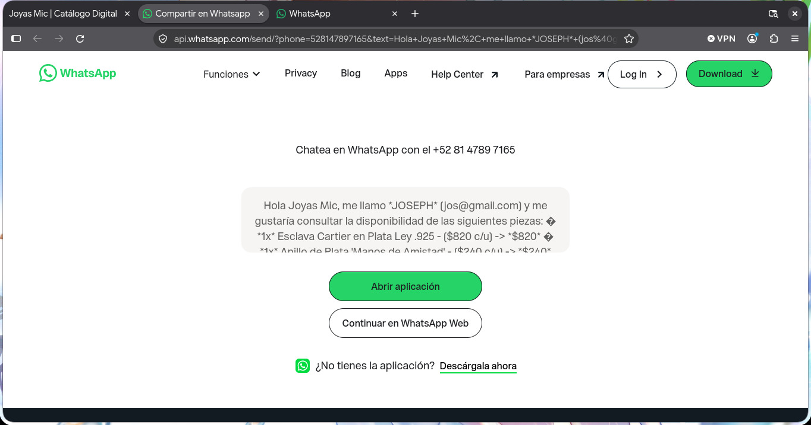
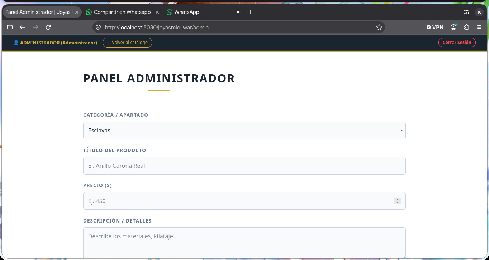
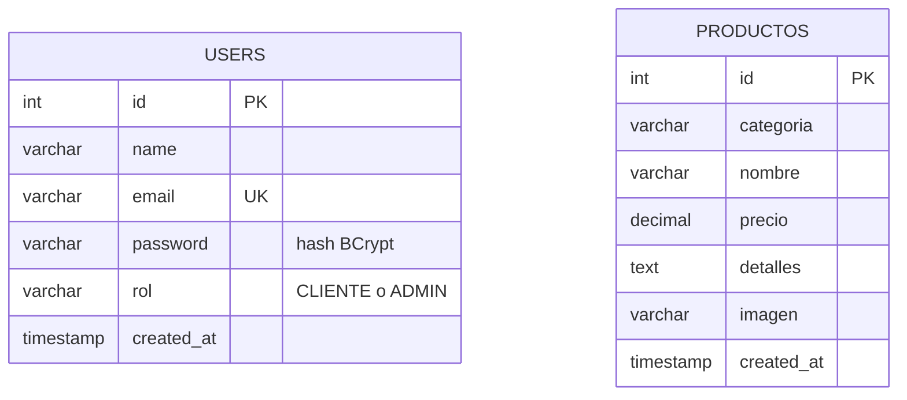

# Joyas Mic — Catálogo Digital y Pedidos (Java EE / Jakarta EE)

Aplicación web dinámica para un negocio de joyería en plata, desarrollada con **Servlets, JSP, JDBC y MySQL/MariaDB** bajo una arquitectura en capas.

---

## 1. Descripción del Proyecto

### Problema
Joyas Mic es un emprendimiento que vende piezas de joyería en plata (esclavas, anillos, collares y aretes). El negocio mostraba su catálogo en una página estática (HTML/CSS/JS con datos guardados en el navegador y un registro en PHP), lo que impedía administrar las piezas de forma segura y centralizada.

### Objetivo del sistema
Migrar la lógica del negocio a una arquitectura web robusta en Java que permita:
- Publicar y administrar el catálogo de piezas en una base de datos relacional.
- Registrar clientes y validar su acceso de forma segura mediante sesiones HTTP (`HttpSession`).
- Armar pedidos en un carrito y enviarlos al negocio por WhatsApp.
- Restringir las tareas administrativas a usuarios con rol de administrador.

### Tipos de usuario
| Rol | Descripción |
|---|---|
| **Cliente** | Se registra e inicia sesión, consulta el catálogo por categorías, arma su carrito y envía el pedido por WhatsApp. |
| **Administrador** | Además de lo anterior, accede al panel `/admin` para publicar y eliminar piezas del catálogo. |

### Tecnologías
| Capa | Tecnología |
|---|---|
| Vistas | JSP, JSTL, HTML5, CSS3, JavaScript (solo para abrir/cerrar modal y carrito) |
| Controladores | Servlets Jakarta (`doGet` / `doPost`) y Filtros |
| Lógica de negocio | Clases *Service* en Java 17 |
| Persistencia | JDBC con `PreparedStatement`, MySQL / MariaDB |
| Seguridad | BCrypt para contraseñas, `HttpSession`, filtro por rol |
| Servidor | Apache Tomcat 11 (Servlet 6.1, JSP 4.0) |
| Construcción | Maven (empaquetado WAR) |

### Arquitectura en capas


| Capa | Paquete / carpeta | Responsabilidad |
|---|---|---|
| Presentación | `presentacion/`, `webapp/WEB-INF/jsp`, `webapp/WEB-INF/jspf` | Recibir peticiones GET/POST, redirigir y mostrar vistas |
| Negocio | `negocio/` | Validaciones, BCrypt, carrito, mensaje de WhatsApp, manejo de imágenes |
| Datos | `datos/` | Conexión y consultas con `PreparedStatement` (DAO) |
| Modelo (DTO) | `modelo/` | `Usuario`, `Producto`, `Carrito`, `ItemCarrito` |

---

## 2. Lista de Funcionalidades

### Módulo de autenticación y control de sesiones
- Registro de usuarios con validaciones del lado del servidor:
  - **VF1:** campos obligatorios, sin vacíos.
  - **VF2:** correo y contraseña sin espacios en blanco.
  - **VF4:** el correo no puede estar duplicado.
  - **VF7:** contraseña de mínimo 8 caracteres.
  - El nombre solo admite letras y espacios, y se guarda en mayúsculas.
- Inicio de sesión verificando la contraseña contra el hash BCrypt guardado en la base de datos.
- Sesión con `HttpSession` y regeneración del identificador al iniciar sesión (previene fijación de sesión).
- Cierre de sesión (`/auth/logout`) que invalida la sesión.
- Control de acceso por rol: el filtro `AdminFilter` protege todas las rutas `/admin/*`.

### Módulo de catálogo
- Listado de piezas leído desde la base de datos.
- Filtro por categoría: Esclavas, Anillos, Collares y Aretes.

### Módulo de carrito y pedidos
- Agregar piezas al carrito (requiere sesión iniciada).
- Aumentar o disminuir cantidades; cálculo automático del total.
- Envío del pedido por WhatsApp con el detalle de piezas, cantidades y total.

### Módulo de administración (solo Administrador)
- **Altas:** publicar una pieza con categoría, título, precio, descripción e imagen (JPG, PNG, GIF o WEBP, máximo 5 MB).
- **Consultas:** tabla con todas las piezas publicadas.
- **Bajas:** eliminar una pieza del catálogo (también se borra su imagen).

### Seguridad y calidad de código
- Consultas preparadas (`PreparedStatement`) en todos los DAO: protección contra inyección SQL.
- Contraseñas con BCrypt (factor de costo 12).
- Salida escapada con `<c:out>` en las vistas: protección contra XSS.
- Validación de extensión y tamaño de las imágenes; nombres generados con UUID y protección contra *path traversal*.
- Mensajes de error controlados: el detalle técnico se registra en el log y no se muestra al usuario.

---

## 3. Guía de Uso

> Las capturas se guardan en la carpeta `docs/capturas/`.

### Flujo del cliente
1. **Catálogo:** al abrir la aplicación se muestra el catálogo con las piezas disponibles. Las pestañas superiores filtran por categoría.

   

2. **Registro / inicio de sesión:** desde **Iniciar Sesión / Registrarse** se abre una ventana con dos pestañas. Si hay un error de validación, el mensaje aparece en la parte superior.

   

3. **Carrito:** con la sesión iniciada, el botón **Agregar al Carrito** abre el panel lateral con las piezas, las cantidades (+ / −) y el total.

   

4. **Pedido:** el botón **Pedir por WhatsApp** abre una conversación con el mensaje del pedido ya armado.

   

### Flujo del administrador
1. Inicia sesión con una cuenta de rol administrador (ventana de inicio de sesión del catálogo).
2. En la barra superior aparece **Panel Admin**.
3. **Publicar pieza:** completa el formulario (categoría, título, precio, descripción, imagen) y pulsa **Publicar en Catálogo**.
4. **Eliminar pieza:** desde la tabla del panel, o desde el botón **Eliminar** que ve sobre cada tarjeta del catálogo.

   

### Mapa de rutas
| Ruta | Método | Descripción | Acceso |
|---|---|---|---|
| `/` y `/catalogo` | GET | Catálogo (parámetro opcional `categoria`) | Público |
| `/auth/registro` | POST | Registrar usuario | Público |
| `/auth/login` | POST | Iniciar sesión | Público |
| `/auth/logout` | POST | Cerrar sesión | Autenticado |
| `/carrito/agregar` | POST | Agregar pieza al carrito | Autenticado |
| `/carrito/cambiar` | POST | Aumentar o disminuir cantidad | Autenticado |
| `/carrito/whatsapp` | GET | Redirigir a WhatsApp con el pedido | Autenticado |
| `/admin` | GET | Panel de administración | Administrador |
| `/admin/publicar` | POST | Alta de pieza (multipart) | Administrador |
| `/admin/eliminar` | POST | Baja de pieza | Administrador |
| `/imagenes/{archivo}` | GET | Sirve las imágenes de las piezas | Público |

---

## 4. Modelo de Datos

Base de datos: `joyas_mic` (script completo en [`sql/joyas_mic.sql`](sql/joyas_mic.sql)).

### Diagrama Entidad-Relación

Las dos tablas son independientes: el carrito vive en la sesión HTTP y el pedido se envía por WhatsApp, por lo que no se almacena en la base de datos.

### Tabla `users`
| Columna | Tipo | Descripción |
|---|---|---|
| `id` | INT, AUTO_INCREMENT, PK | Identificador |
| `name` | VARCHAR(100) | Nombre completo en mayúsculas |
| `email` | VARCHAR(150), UNIQUE | Correo (usuario de acceso) |
| `password` | VARCHAR(100) | Hash BCrypt de la contraseña |
| `rol` | VARCHAR(10), default `CLIENTE` | `CLIENTE` o `ADMIN` |
| `created_at` | TIMESTAMP | Fecha de registro |

### Tabla `productos`
| Columna | Tipo | Descripción |
|---|---|---|
| `id` | INT, AUTO_INCREMENT, PK | Identificador |
| `categoria` | VARCHAR(30) | Esclavas, Anillos, Collares o Aretes |
| `nombre` | VARCHAR(150) | Título de la pieza |
| `precio` | DECIMAL(10,2) | Precio de venta |
| `detalles` | TEXT | Descripción, materiales y kilataje |
| `imagen` | VARCHAR(255) | Nombre del archivo de imagen |
| `created_at` | TIMESTAMP | Fecha de publicación |

---

## 5. Instrucciones de Instalación

### Requisitos
- JDK 17 o superior
- Apache Tomcat 11
- MySQL o MariaDB (por ejemplo, el que incluye XAMPP)
- Maven (viene integrado en IntelliJ IDEA)

### Paso 1. Clonar el repositorio
```bash
git clone https://github.com/USUARIO/joyasmic.git
cd joyasmic
```

### Paso 2. Crear la base de datos
Con la base de datos encendida, ejecuta el script desde phpMyAdmin (pestaña **SQL**) o desde la terminal:
```bash
mysql -h 127.0.0.1 -u root -p < sql/joyas_mic.sql
```
En XAMPP para Linux el cliente está en `/opt/lampp/bin/mysql`. Ejecuta el script **una sola vez**, porque inserta los productos de ejemplo.

### Paso 3. Configurar la aplicación
```bash
cp src/main/resources/db.properties.example src/main/resources/db.properties
```
Edita `db.properties` con los datos de tu entorno:

| Propiedad | Descripción |
|---|---|
| `db.url`, `db.user`, `db.password` | Conexión a la base de datos |
| `admin.email`, `admin.password` | Administrador inicial; se crea automáticamente al arrancar si no existe |
| `whatsapp.numero` | Número en formato internacional, sin `+` (ej. `52` + 10 dígitos) |
| `uploads.dir` | Carpeta de imágenes subidas (vacío = `~/joyasmic-uploads`) |

Coloca las imágenes de ejemplo `esclava.jpg`, `anillo.jpg` y `collar.jpg` en `src/main/webapp/img/`.

### Paso 4. Desplegar en Tomcat 11

**Opción A: IntelliJ IDEA Ultimate**
1. **File → Open** y selecciona la carpeta del proyecto (la que contiene `pom.xml`). Espera a que Maven descargue las dependencias.
2. **File → Project Structure → Artifacts → + → Web Application: Exploded → From Modules…** y elige el módulo `joyasmic`.
3. **Run → Edit Configurations → + → Tomcat Server → Local**, y en *Application server* selecciona tu instalación de Tomcat 11.
4. Pestaña **Deployment → + → Artifact →** `joyasmic:war exploded`; en *Application context* escribe `/`.
5. Pulsa **Run**.

**Opción B: línea de comandos**
```bash
mvn clean package
cp target/joyasmic.war /ruta/a/tomcat11/webapps/
/ruta/a/tomcat11/bin/startup.sh
```
Con este método la aplicación queda en `http://localhost:8080/joyasmic/`.

### Paso 5. Probar
Abre `http://localhost:8080/` y verifica:
- El catálogo muestra las piezas y las pestañas filtran por categoría.
- Puedes registrarte y la sesión queda iniciada.
- El carrito suma las piezas y el botón de WhatsApp abre el pedido.
- Con el administrador (`admin.email` / `admin.password` de `db.properties`) aparece **Panel Admin**.

En la consola de Tomcat debe aparecer el mensaje *"Administrador inicial creado"* la primera vez que arranca.

### Solución de problemas
| Síntoma | Causa probable |
|---|---|
| Error 500 al abrir el catálogo | La base de datos está apagada o no se ejecutó `sql/joyas_mic.sql` |
| `Access denied for user` | Usuario o contraseña incorrectos en `db.properties` |
| No aparece el administrador | La tabla `users` no tiene la columna `rol` |
| Las imágenes de ejemplo no se ven | Falta copiar los `.jpg` a `src/main/webapp/img/` |

---

## Estructura del proyecto
```
joyasmic/
├── pom.xml
├── sql/joyas_mic.sql
├── docs/capturas/
└── src/main/
    ├── java/com/joyasmic/
    │   ├── modelo/          Usuario, Producto, Carrito, ItemCarrito
    │   ├── datos/           ConexionBD, UsuarioDAO, ProductoDAO
    │   ├── negocio/         UsuarioService, ProductoService, CarritoService, AlmacenImagenes
    │   ├── presentacion/    Servlets, AdminFilter, AppListener
    │   └── util/            Config
    ├── resources/           db.properties.example
    └── webapp/
        ├── css/  img/  index.jsp
        └── WEB-INF/         web.xml, jsp/, jspf/
```

## Equipo

| Integrante | Enfoque principal |
|---|---|
| Callejas Rodríguez Cristian Miguel | Base de datos y capa DAO |
| Fragoso Anaya Natalia | Base de datos y capa DAO |
| Hernández Morales Johan Manuel | Lógica de negocio y Servlets |
| Herrera Rivero Emilio Josef | Lógica de negocio y Servlets |
| Bautista González Joseph Isai | Vistas JSP y GitHub |
